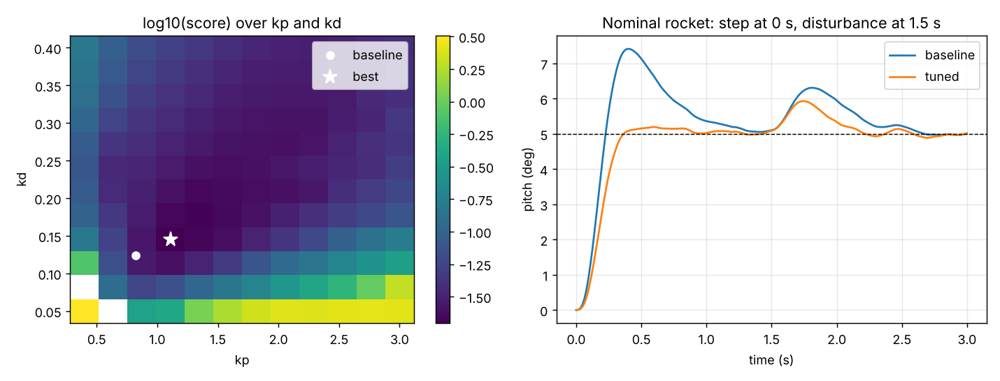
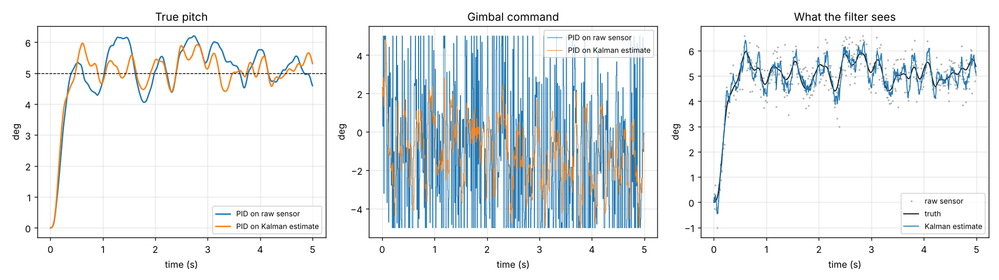

# rocket-pid

A staged control-systems project: keep a small thrust-vectored rocket upright in simulation. It starts with no controller, builds up to a tuned PID, tests it against a rocket that does not match the model, then goes past PID with LQR and a Kalman filter.

Everything is Python (NumPy, SciPy, Matplotlib). No hardware yet.

## The plant

One axis: pitch. The motor gimbals to steer.

```
I * theta'' = T * L * sin(delta) + c_aero * theta - c_damp * omega + disturbance
delta'      = (delta_cmd - delta) / servo_tau
```

| Symbol | Meaning | Value |
| --- | --- | --- |
| theta | pitch angle from vertical | state |
| delta | gimbal angle | limited to 5 deg, 150 deg/s |
| I | pitch inertia | 0.05 kg m^2 |
| T | thrust | 15 N |
| L | gimbal to center of mass | 0.30 m |
| c_aero | aero torque per radian of tilt | 0.5 N m/rad |
| servo_tau | servo time constant | 0.03 s |

`c_aero` is positive, so the rocket is unstable: any tilt grows on its own. The physics runs at 1 kHz (RK4) and the controller at 100 Hz.

## Quick start

```
git clone <your repo url>
cd rocket-pid
python -m venv .venv
source .venv/bin/activate        # Windows: .venv\Scripts\activate
pip install -r requirements.txt

python run_all.py                # runs every stage, about 10 s
python stages/04_pid_control.py  # or run one stage
python -m pytest                 # tests
```

Each stage prints its numbers and saves a plot to `figures/`.

## Stages

| Stage | File | Question | Result |
| --- | --- | --- | --- |
| 1 | `01_open_loop.py` | What happens with no control? | A 1 deg tilt grows until the rocket falls over. One open-loop pole is at +2.97. |
| 2 | `02_p_control.py` | Is P enough? | No. It swings back and forth and the swings grow. More gain is worse. |
| 3 | `03_pd_control.py` | Does D fix it? | Yes, it is stable, but it settles 0.8 deg off target. Gains come from a target natural frequency (8 rad/s) and damping ratio (0.7). |
| 4 | `04_pid_control.py` | Does I remove the error? | Yes, including under a constant side torque. Overshoot goes up to 50%. |
| 5 | `05_realism.py` | What breaks on real hardware? | Windup, derivative kick, noise, overshoot. One fix for each (below). |
| 6 | `06_tuning.py` | What are the best gains? | Grid sweep scored by ITAE across three versions of the rocket. |
| 7 | `07_robustness.py` | Does it survive a wrong model? | 100 randomized rockets, 0 failures. Loop gain can change from 0.5x to 3.2x. |
| 8 | `08_lqr.py` | What does LQR do differently? | Half the error under a disturbance, more overshoot on a step. |
| 9 | `09_kalman.py` | What if the sensor is bad? | The filter cuts angle error by 40% and gimbal jitter by half. |

### Stage 5 fixes

| Problem | Without fix | With fix |
| --- | --- | --- |
| Integrator windup on a 12 deg step | rocket falls over | peaks at 18.9 deg and recovers |
| Derivative kick on a setpoint step | 66 deg gimbal command spike | 4.2 deg |
| Sensor noise (0.05 deg rms) through the D term | 0.92 deg rms gimbal jitter | 0.40 deg |
| Overshoot on a 5 deg step | 50% | 3.8% (setpoint weight 0.5) |

### Baseline vs tuned (5 deg step, nominal rocket)

| | kp | ki | kd | setpoint weight | overshoot | settle (5%) |
| --- | --- | --- | --- | --- | --- | --- |
| Baseline (stage 3 formula + I) | 0.82 | 1.5 | 0.124 | 1.0 | 48% | 1.15 s |
| Tuned (stage 6 sweep) | 1.11 | 3.1 | 0.145 | 0.4 | 4% | 0.32 s |

Gains are in radians of gimbal per radian of pitch error.



### PID vs LQR (stage 8)

| | overshoot | largest error after disturbance |
| --- | --- | --- |
| Tuned PID | 3.7% | 0.98 deg |
| LQR with integral state | 18.2% | 0.47 deg |

The LQR here has no setpoint weighting, which is most of the overshoot difference.

### Kalman filter (stage 9, 0.5 deg rms angle sensor, no gyro)

| | pitch error | gimbal jitter |
| --- | --- | --- |
| PID on raw sensor | 0.54 deg rms | 3.6 deg rms |
| PID on Kalman estimate | 0.41 deg rms | 1.6 deg rms |

The filter estimates angle, rate and an unknown disturbance torque. Without the disturbance state its angle estimate was biased whenever an outside torque was applied.



## Layout

```
rocketpid/
  plant.py      rocket and servo dynamics, RK4 step, linearized model
  pid.py        PID with clamp, anti-windup, D on measurement, D filter, setpoint weight
  sim.py        simulation loop (1 kHz physics, 100 Hz control, sensor noise)
  metrics.py    rise time, overshoot, settling time, ITAE
  kalman.py     3-state Kalman filter
stages/         one script per stage, plus common.py for shared gains and plotting
tests/          pytest checks for the PID and the closed loop
figures/        plots written by the stages
run_all.py      runs all stages in order
```

## Limits of the model

- One axis only. No roll, yaw or translation.
- Thrust, mass and inertia are constant. A real motor's thrust curve and burning propellant change all three.
- Aero torque is linear in angle and does not depend on airspeed.
- Sensor noise is white. No gyro bias or drift, no sensor delay.
- The parameter values are plausible for a small model rocket, not measured from one.

## Next steps

- Gain scheduling for a real thrust curve
- Second axis and a quaternion attitude model
- Gyro plus accelerometer fusion in the Kalman filter
- Hardware: gimbal mount, two servos, IMU, flight computer, static tests before any flight
